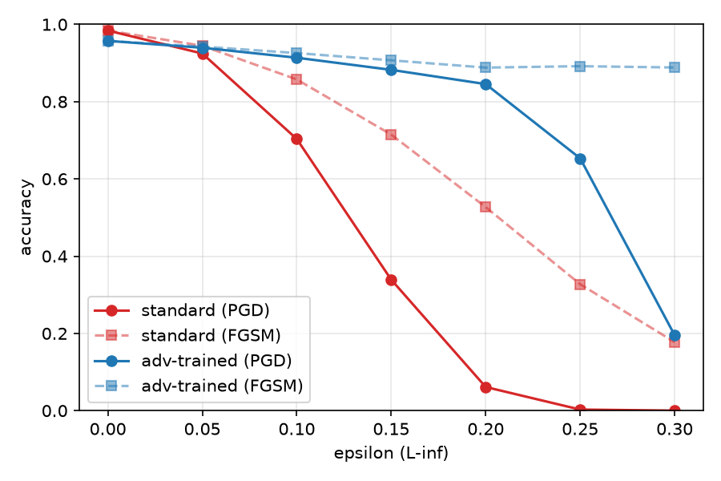

# MNIST Adversarial Attack & PGD Adversarial Training

MNIST 분류 CNN에 대해 FGSM / PGD (L∞)를 구현하고, **PGD adversarial training**(Madry et al., 2018)으로 방어했을 때 robust accuracy가 어떻게 달라지는지 측정한다.



## 결과 요약

- test set: 10,000장 / 평가용 PGD: 40 step(random start, α = 2.5·ε/steps) / 학습용 PGD: 10 step
- training ε: 0.2 / 모델별 학습: 각 1회

| ε | standard / FGSM | standard / PGD | adv-trained / FGSM | adv-trained / PGD |
|---|---|-------------|---|-----------------|
| 0 (clean) | 98.4% | 98.4% | 95.7% | 95.7% |
| 0.05 | 94.5% | 92.5% | 94.3% | 94.0% |
| 0.1 | 85.8% | 70.3% | 92.6% | 91.4% |
| 0.15 | 71.5% | 33.9% | 90.7% | 88.2% |
| 0.2 | 52.7% | 6.1% | 88.8% | 84.5% |
| 0.25 | 32.7% | 0.3% | 89.2% | 65.3% |
| 0.3 | 17.7% | 0.0% | 88.8% | 19.5% |

- training ε에서 PGD accuracy가 **6.1% → 84.5%** 로 올랐으나, clean accuracy는 **98.4% → 95.7%** 로 낮아졌다.
- training ε를 넘는 ε=0.3에서 PGD accuracy가 19.5%로 다시 크게 떨어졌다.
- adv-trained 모델의 FGSM accuracy는 ε=0.2~0.3에서 약 89%로 거의 변하지 않았으나, PGD는 19.5%까지 내려갔다. **이 모델에서는 FGSM 수치를 방어 성능 근거로 쓸 수 없고**, PGD 기준으로만 해석해야 한다 (자세한 내용은 [report.md](report.md)).
- 위 표는 한 번 학습한 가중치 기준이고 같은 설정으로 다시 학습하면 수치가 달라진다.

## 구성

| 파일 | 내용                                                                 |
|---|--------------------------------------------------------------------|
| `train.py` | MNIST loader, 작은 CNN(conv 2 + fc 3), 일반 학습 → `mnist_cnn.pt`        |
| `attack.py` | `fgsm`, `pgd`(L∞, random start), `eval_attack`                     |
| `adv_train.py` | PGD adversarial training (ε=0.2, 학습용 10 step) → `mnist_cnn_adv.pt` |
| `compare.py` | 두 모델을 ε별 FGSM/PGD로 평가하고 표와 그래프 생성                                  |
| `visualize.py` | 원본/공격 이미지 비교 그림 생성                                                 |

## 실행 방법

```bash
python -m venv .venv
.venv\Scripts\activate          # Windows
pip install -r requirements.txt

python train.py        # standard 모델 학습 (5 epoch)
python attack.py       # FGSM vs PGD 평가
python adv_train.py    # adversarial training (10 epoch)
python compare.py      # 비교표와 results/robust_accuracy.png 생성
python visualize.py    # results/fgsm_examples.png 생성
```

`train.py`, `adv_train.py`는 같은 이름의 가중치 파일을 **덮어쓴다.** 다시 학습하면 결과표의 수치도 달라진다. 저장소에 가중치(`mnist_cnn.pt`, `mnist_cnn_adv.pt`)가 들어 있으므로 `train.py`와 `adv_train.py`를 건너뛰고 `attack.py`, `compare.py`만 실행해도 표를 확인할 수 있다.

## 구현 요약

- **위협 모델**: white-box, untargeted, L∞ (픽셀당 |δ| ≤ ε), 픽셀 범위 [0, 1] 유지
- **FGSM**: `x_adv = clip(x + ε · sign(∇ₓL))`
- **PGD**: random start 후 매 step `x_adv += α · sign(∇ₓL)` → 원본 x 기준 `[-ε, ε]`로 projection → `[0, 1]`로 clip
- **Adversarial training**: batch마다 *현재 모델*에 대해 PGD(10 step)를 새로 만들고, 그 이미지에서의 cross-entropy로 가중치를 업데이트한다. 공격 생성 중에는 `eval()`, 업데이트 때는 `train()`으로 전환한다.
- **평가**: 학습용(10 step)보다 강한 PGD 40 step으로 test 전체를 측정한다.

## 한계

- **각 모델을 1회만 학습했다.** 학습마다 결과가 달라지는 변동 폭을 측정하지 못했다.
- PGD는 random start 때문에 같은 가중치로 다시 평가해도 0.3%p 안팎(최대 0.5%p 정도)으로 흔들린다. FGSM은 항상 같다.
- 평가 공격이 **PGD-40 하나뿐**이라, 표의 수치는 "이 공격에 대한 accuracy"이고, 어떤 공격을 써도 맞히는 비율(진짜 robust accuracy)의 **상한**이다.
- L∞ norm 제약만 다뤘다. training ε를 넘는 공격(ε=0.3)에는 accuracy가 크게 떨어진다.
- 모델이 작고(conv 6/16 channel) 데이터가 MNIST이므로 결과를 더 큰 모델이나 다른 데이터셋으로 일반화할 수 없다.

## 참고 문헌

- Goodfellow, Shlens, Szegedy. *Explaining and Harnessing Adversarial Examples.* ICLR 2015.
- Madry, Makelov, Schmidt, Tsipras, Vladu. *Towards Deep Learning Models Resistant to Adversarial Attacks.* ICLR 2018.
