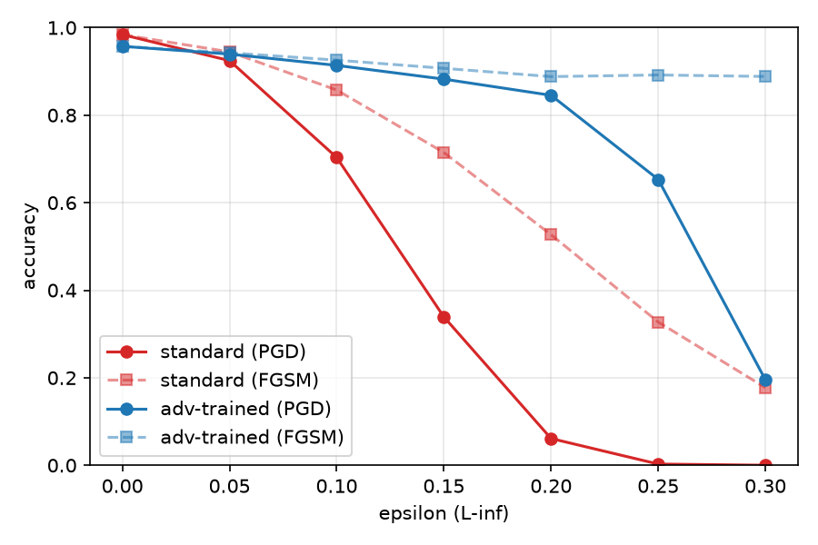
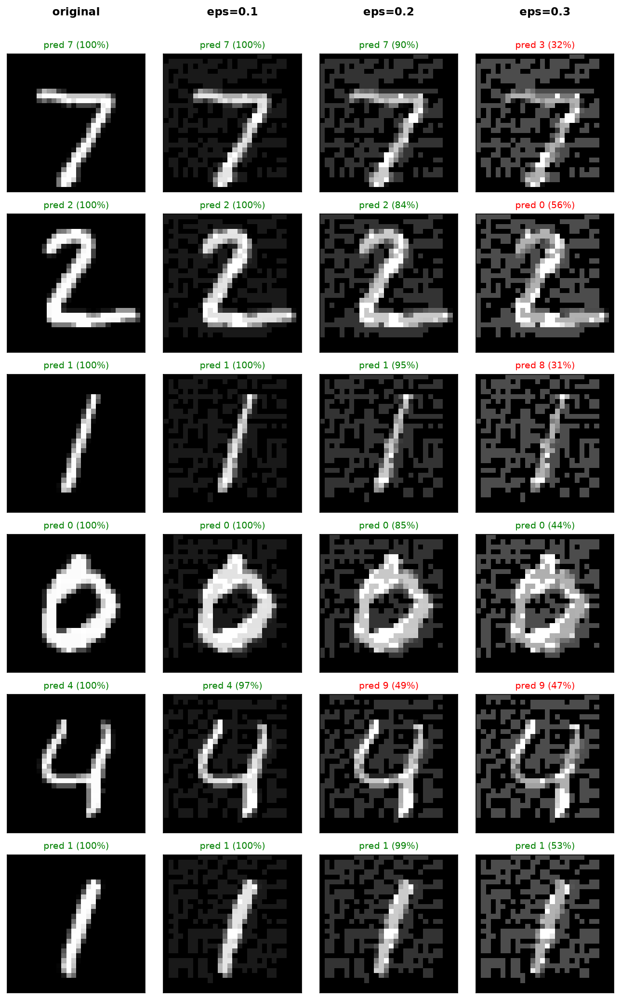

# MNIST 분류기에 대한 FGSM/PGD 공격과 PGD Adversarial Training

## 1. 목적

이미지 분류 모델이 입력의 작은 변화에 얼마나 취약한지 측정하고, adversarial training이 이를 얼마나 완화하는지 확인한다. 공격 알고리즘(FGSM, PGD)과 방어(PGD adversarial training)를 공격 라이브러리 없이 직접 구현했다.

## 2. 설정

| 항목 | 내용 |
|---|---|
| 데이터 | MNIST (train 60,000 / test 10,000), 픽셀 [0,1], 정규화 없음 |
| 모델 | conv(1→6, 3×3) → pool → conv(6→16, 5×5) → pool → fc 256→120→80→10, dropout 0.5 |
| 학습 | Adam(lr 1e-3), batch 64, 5 epoch (standard) / 10 epoch (adv-trained) |
| 위협 모델 | white-box, untargeted, L∞ |
| 공격 | FGSM, PGD(random start, 40 step, α = 2.5·ε/steps) |
| 방어 | PGD adversarial training, training ε=0.2, 10 step |
| 평가 | test 10,000장 전체, ε ∈ {0, 0.05, …, 0.3} |

## 3. 방법

**FGSM**은 정답 라벨에 대한 loss의 입력 gradient 부호 방향으로 한 번 이동한다.

`x_adv = clip(x + ε · sign(∇ₓ L(f(x), y)))`

이 방향은 loss를 1차 근사로 선형화했을 때 L∞ 제약(픽셀당 ε) 안에서 loss를 가장 크게 올리는 방향이다.

**PGD**는 같은 방향으로 작은 보폭 α씩 `steps`번 이동하며, 매번 원본 x를 중심으로 하는 ε-상자 `[x-ε, x+ε]`와 이미지 범위 `[0,1]`로 projection한다. 모델이 비선형이라 gradient 방향이 걸음마다 바뀌므로 FGSM보다 같은 ε에서 더 높은 loss를 찾는다.

**Adversarial training**은 `min_θ E[ max_{‖δ‖∞≤ε} L(f_θ(x+δ), y) ]`를 근사한다. 안쪽 max를 batch마다 *현재 모델*에 대한 PGD로 풀고, 바깥 min을 그 공격 이미지에서의 loss로 가중치를 업데이트하는 방식이다. 가중치가 바뀌면 최적의 공격도 바뀌기 때문에 공격 이미지를 미리 만들어 두지 않고 매 batch에서 새로 만든다.

## 4. 결과

| ε | standard / FGSM | standard / PGD | adv-trained / FGSM | adv-trained / PGD |
|---|---|---|---|---|
| 0 | 98.4% | 98.4% | 95.7% | 95.7% |
| 0.05 | 94.5% | 92.5% | 94.3% | 94.0% |
| 0.1 | 85.8% | 70.3% | 92.6% | 91.4% |
| 0.15 | 71.5% | 33.9% | 90.7% | 88.2% |
| 0.2 | 52.7% | 6.1% | 88.8% | 84.5% |
| 0.25 | 32.7% | 0.3% | 89.2% | 65.3% |
| 0.3 | 17.7% | 0.0% | 88.8% | 19.5% |

## 5. 해석

1. **공격은 작은 변화로도 accuracy를 크게 낮춘다.** standard 모델은 ε=0.1에서 PGD accuracy 70.3%, ε=0.2에서 6.1%로 떨어졌다. 같은 ε에서 PGD가 FGSM보다 항상 더 낮은 accuracy를 만들었다.
2. **Adversarial training은 training ε 근처에서 효과가 크다.** ε=0.2에서 PGD accuracy가 6.1% → 84.5%로 올랐다.
3. **accuracy와 robustness 사이에 trade-off가 있다.** clean accuracy가 98.4% → 95.7%로 낮아졌고, batch마다 PGD 10 step의 forward/backward가 추가되어 연산량이 일반 학습의 약 11배이며, CPU에서 epoch당 52~102초가 걸렸다.
4. **일반화에는 한계가 있다.** training ε(0.2)를 넘는 ε=0.25, 0.3에서 PGD accuracy가 65.3%, 19.5%로 급격히 떨어졌다.
5. **FGSM 수치를 그대로 믿으면 안 되는 경우가 있다.** adv-trained 모델은 ε=0.2~0.3에서 FGSM accuracy가 약 89%로 거의 변하지 않는데 PGD는 19.5%까지 내려간다. 단일 step 공격이 이 모델에서는 효과적이지 않고, FGSM만으로 평가했다면 robustness를 크게 과대평가했을 것이다.

## 6. 한계

- **각 모델을 한 번만 학습했다.** 학습마다 결과가 달라지는데 그 변동 폭을 측정하지 못했다. 표의 수치는 한 번의 학습 결과로만 읽어야 한다.
- PGD는 random start 때문에 같은 가중치로 다시 평가해도 0.3%p 안팎(최대 0.5%p 정도)으로 변한다. FGSM은 항상 같다.
- 평가 공격이 PGD-40 하나로, 수치는 이 공격에 대한 accuracy이며 어떤 공격을 써도 맞히는 비율(진짜 robust accuracy)의 상한이다.
- L∞ norm 제약, 작은 CNN, MNIST로 한정된 결과이며 다른 설정으로 일반화할 수 없다.

## 참고 문헌

- Goodfellow, Shlens, Szegedy. *Explaining and Harnessing Adversarial Examples.* ICLR 2015.
- Madry, Makelov, Schmidt, Tsipras, Vladu. *Towards Deep Learning Models Resistant to Adversarial Attacks.* ICLR 2018.
